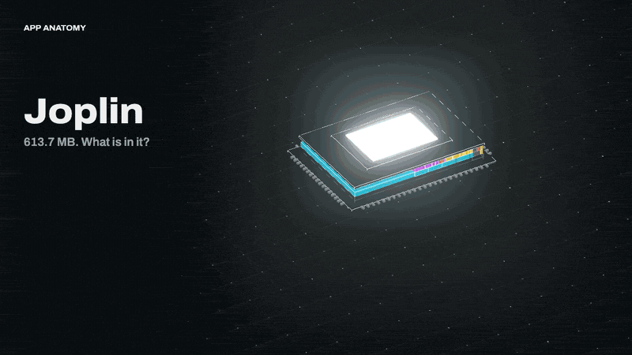
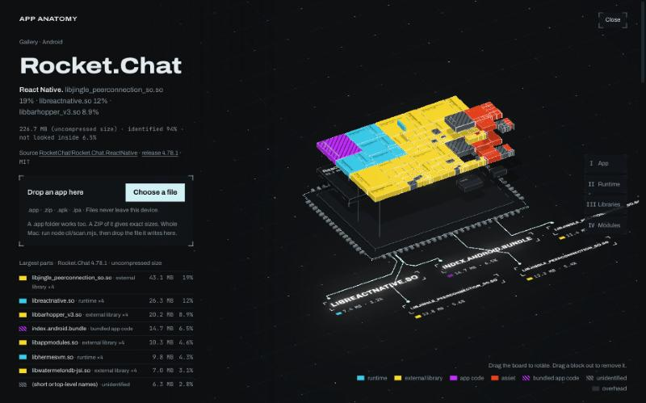
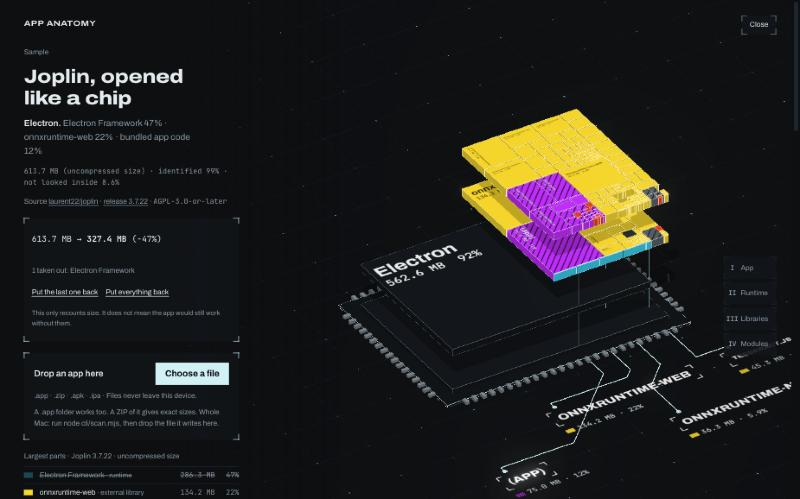
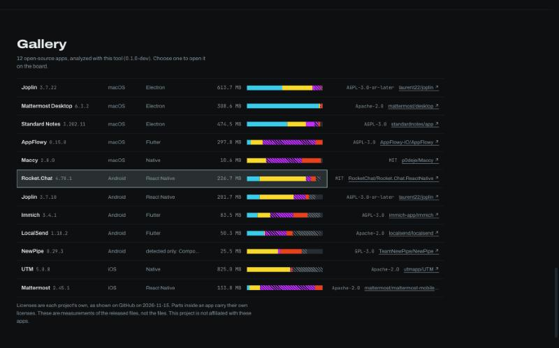
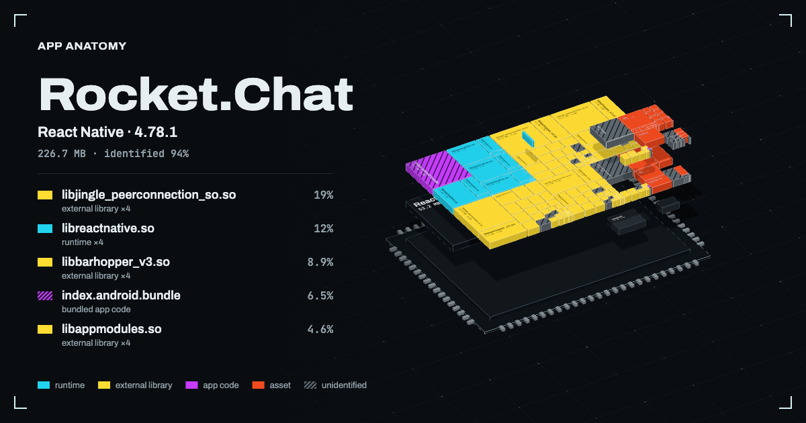

<h1 align="center">App Anatomy</h1>

<p align="center">
  <b>내 맥의 앱이 무엇으로 만들어졌는지 봅니다.</b><br>
  런타임, 라이브러리, 자체 코드, 에셋을 바이트 단위로. 아무것도 올라가지 않습니다.
</p>

<p align="center">
  <a href="https://github.com/scs0209/app-anatomy/actions/workflows/rules.yml"></a>
  <a href="https://www.npmjs.com/package/app-anatomy"></a>
  <a href="package.json"></a>
  <a href="LICENSE"></a>
  
</p>

<p align="center">
  <a href="https://scs0209.github.io/app-anatomy/?lang=ko"><b>브라우저에서 해 보기</b></a> ·
  <a href="#-빠른-시작"><b>빠른 시작</b></a> ·
  <a href="#-읽는-법"><b>읽는 법</b></a> ·
  <a href="#-갤러리">갤러리</a> ·
  <a href="#-동작-방식">동작 방식</a> ·
  <a href="CONTRIBUTING.md">규칙 기여(영문)</a> ·
  <a href="README.md">English</a>
</p>

<p align="center">
  
</p>

---

메모 앱 Joplin은 맥에서 613.7 MB입니다. 그중 47%는 Electron 프레임워크, 22%는 AI 추론 런타임(onnxruntime-web)이고,
앱 자체의 코드 묶음은 12%입니다. App Anatomy는 앱을 칩 패키지처럼 열어서 이것을 보여 줍니다. 부품 하나가 블록 하나이고,
크기는 바이트, 색은 그 부품이 어디서 왔는지입니다.

명령 한 줄로 맥에 설치된 앱을 모두 훑습니다. 앱을 읽기만 하고 실행하지 않으며, 아무것도 이 기기를 떠나지 않습니다.

## ✨ 왜 App Anatomy인가

| | |
|---|---|
| 🖥 **명령 한 줄로 맥 전체** | `npx app-anatomy scan --open`이 `/Applications`의 앱을 모두 읽고, Electron이 몇 벌 깔려 있고 합쳐서 디스크를 얼마나 쓰는지 같은 것을 알려 줍니다. |
| 📦 **앱 하나도** | `.app` 폴더, `.app`이 든 ZIP, Android APK, iOS IPA. Electron, Flutter, React Native, 네이티브 앱을 알아봅니다. |
| 🧩 **열어 볼 수 있는 칩** | 면적은 바이트, 높이는 층(앱, 런타임, 라이브러리, 모듈), 색은 출처입니다. 카메라가 정사영이라 같은 면적은 같게 보입니다. |
| ✋ **블록을 빼면 무엇이 무너지는지** | 블록을 칩에서 끌어내면 크기를 다시 세고, 그 블록을 필요로 한다고 적힌 부품들이 함께 어두워집니다. Joplin에서 0.4 MB짜리 `onnxruntime-common`을 빼면 218 MB가 함께 무너집니다. |
| 🔒 **아무것도 올라가지 않음** | 해석기는 Rust를 WebAssembly로 지은 것이고 이 기기에서 돕니다. 결과 화면은 `127.0.0.1`에서 띄우며 바깥으로 요청을 보내지 않습니다. |
| 🧾 **모르는 것은 모른다고** | 식별하지 못한 부품은 회색 빗금으로 남습니다. 부모의 바이트는 언제나 자식의 합과 같습니다. |
| 🤝 **누구나 더할 수 있는 규칙** | 부품의 이름은 JSON 몇 줄로 정합니다. 지금 651건이 있고, 쓰고 시험하는 데 Node만 있으면 됩니다. |

<p align="center">
  
</p>

## 🚀 빠른 시작

**맥을 훑기** (Node 18 이상이 필요합니다):

```bash
npx app-anatomy scan --open
```

앱마다 한 줄씩 찍고, `this-mac.anatomy-scan.json`을 쓰고, 결과를 브라우저로 엽니다. 이 파일에는 설치한 앱의 목록이
들어 있으니 공유할 때는 그 점을 알고 하세요. `--system`을 붙이면 `/System/Applications`도 넣고, 폴더를 주면 그 폴더를 훑습니다.

**앱 하나를 들여다보기:**

```bash
npx app-anatomy path/to/Some.app                     # 터미널에 요약
npx app-anatomy some.apk --json result.json          # 전체 결과를 JSON으로
```

```
android-release.apk · apk · 226.7 MB (uncompressed)
runtime: react-native 23.5%
largest: libjingle_peerconnection_so.so 19.0% · libreactnative.so 11.6% · libbarhopper_v3.so 8.9%
identified 94.0% · not looked inside 6.5% · overhead 2.8%
```

**브라우저에서 끌어다 놓기:** [scs0209.github.io/app-anatomy](https://scs0209.github.io/app-anatomy/?lang=ko)에서 터미널 없이 같은 일을 합니다.
앱 파일을 놓거나 [갤러리](https://scs0209.github.io/app-anatomy/?app=rocket-chat&lang=ko)를 둘러보세요. 파일은 브라우저 탭 안에서 해석되고 탭을 떠나지 않습니다.
저장해 둔 결과 JSON을 다시 열 수도 있습니다. 사이트는 영어와 한국어로 볼 수 있고 오른쪽 위에서 바꿉니다. 직접 띄우려면:

```bash
git clone https://github.com/scs0209/app-anatomy && cd app-anatomy
node site/build.mjs && python3 -m http.server 8767 --bind 127.0.0.1 --directory site-dist
```

## 🧭 읽는 법

| 표시 | 뜻 |
|---|---|
| 블록의 **면적** | 바이트(압축을 푼 크기) |
| 놓인 **높이** | 층: 앱, 런타임, 라이브러리, 모듈 |
| **색** | 부품의 출처: 런타임, 외부 라이브러리, 앱 자체 코드, 에셋 |
| **회색 빗금** | 미식별: 아직 이름을 붙인 규칙이 없음 |
| **색 위의 빗금** | 누구의 것인지는 알지만 안쪽은 들여다보지 않음(예: 앱의 코드 묶음) |
| **회로선과 이름표** | 가장 큰 부품들의 크기와 비중 |
| **색을 잃고 내려앉은 블록** | 빼낸 블록을 필요로 한다고 적혀 있던 부품 |

표시 하나는 뜻 하나만 가집니다. 장식을 출처 색으로 그리지 않습니다.

## 📸 화면

| | |
|---|---|
|  |  |
| **빼 보기**: 블록을 칩에서 끌어내거나 표의 줄을 누르면 크기를 다시 셉니다 | **갤러리**: 공개 앱 열두 개와 각각의 소스 저장소, 라이선스 |
|  | |
| **공유 카드**: 지금 잡은 구도 그대로 1200×630 그림으로, 브라우저 안에서 만듭니다 | |

화면 사진은 영어 화면에서 찍은 것입니다. 좁은 화면에서는 칩 대신 같은 면적과 색의 평면 트리맵이 나옵니다.

## 🗂 갤러리

이 도구로 해석한 공개 앱 열두 개입니다. [사이트](https://scs0209.github.io/app-anatomy/?lang=ko)에서 어느 것이든 열어 볼 수 있습니다. 결과는 `site/gallery/`에,
각 앱의 저장소·릴리스·라이선스는 [`site/gallery/SOURCES.md`](site/gallery/SOURCES.md)에 있습니다.

| 앱 | 플랫폼 | 크기 | 만든 방식 | 런타임 비중 | 식별 |
|---|---|---|---|---|---|
| Joplin | macOS | 613.7 MB | Electron | 46.8% | 99.3% |
| Mattermost Desktop | macOS | 280.2 MB | Electron | 94.0% | 99.9% |
| Standard Notes | macOS | 474.5 MB | Electron | 53.4% | 100.0% |
| AppFlowy | macOS | 297.6 MB | Flutter | 5.0% | 100.0% |
| Maccy | macOS | 10.6 MB | 네이티브 | 해당 없음 | 99.7% |
| Rocket.Chat | Android | 226.7 MB | React Native | 17.0% | 94.0% |
| Joplin | Android | 201.7 MB | React Native | 16.9% | 91.3% |
| Immich | Android | 83.5 MB | Flutter | 14.2% | 83.8% |
| LocalSend | Android | 50.3 MB | Flutter | 22.7% | 62.7% |
| NewPipe | Android | 25.5 MB | 네이티브(Compose 감지) | 해당 없음 | 92.9% |
| UTM | iOS | 825.0 MB | 네이티브 | 해당 없음 | 59.9% |
| Mattermost | iOS | 138.0 MB | React Native | 3.5% | 99.9% |

"런타임 비중"은 런타임 자체의 바이트만 셉니다. 터미널 요약의 `runtime:` 줄이 더 크게 나오는 앱이 있는데, 그 줄은 런타임이
싣고 있는 것(React Native라면 JavaScript 묶음)까지 세기 때문입니다. "식별"은 출처를 말할 수 있었던 바이트의 비율입니다.
워크플로가 매주 새 릴리스를 확인해 결과를 갱신하는 풀 리퀘스트를 엽니다. 여기 있는 것은 배포 파일을 잰 결과이며 파일 자체가
아닙니다. 이 프로젝트는 이 앱들과 관계가 없습니다.

## 🧠 동작 방식

```
앱 파일 또는 폴더
  → 호스트가 요청받은 바이트를 읽어 줌 (명령줄은 Node, 브라우저는 Web Worker)
  → 해석기 (Rust, WebAssembly로 지음)
      · 포장을 푼다: .app 번들, ZIP, APK, IPA, asar, dex
      · 런타임을 알아낸다: Electron, Flutter, React Native, 또는 네이티브
      · 규칙으로 부품에 이름을 붙인다: 파일 이름, 프레임워크 이름, 경로, 클래스 접두어, npm 패키지 이름
      · 바이트를 빠짐없이 센다: 부모는 자식의 합과 같다
      · 부품 사이의 선언된 의존을 적는다: npm 패키지 의존, DT_NEEDED, LC_LOAD_DYLIB
  → 결과 JSON 하나 (형식은 schema/)
  → 터미널 요약, 3D 칩, 평면 트리맵, 목록, 공유 카드
```

* **해석기 하나, 호스트 둘.** 명령줄과 브라우저가 같은 WebAssembly 파일을 돌리고, 같은 입력에서 바이트까지 같은 JSON을 냅니다.
* **규칙은 데이터.** `rules/builtin/builtin.json`이 이 프로젝트의 규칙이고, `rules/imported/`는
  [LibChecker-Rules](https://github.com/LibChecker/LibChecker-Rules)에서 변환한 규칙입니다. 정규식은 없고, 정확 일치·접두어·제한된 글롭만 씁니다.
* **정확한 바이트 계산.** 크기는 압축을 푼 값입니다. 어느 부품에도 돌아가지 않은 바이트는 숨기지 않고 overhead로 보입니다.
* **작은 부품은 그릴 때만 묶습니다.** 칩은 아주 작은 부품을 출처별 블록 하나로 묶지만, 목록과 JSON에는 모든 부품이 있습니다.

## 🤝 규칙 기여

회색 빗금 블록은 아직 아무도 이름을 붙이지 않은 부품입니다. 규칙 하나로 Rocket.Chat Android 앱의 식별 비율이 90.9%에서
94.0%가 됐습니다.

```json
{
 "id": "lib.watermelondb",
 "name": "WatermelonDB",
 "kind": "library",
 "category": "other",
 "homepage": "https://github.com/Nozbe/WatermelonDB",
 "match": [
  { "target": "file-name", "type": "literal", "value": "libwatermelondb-jsi.so", "packaging": ["apk"] }
 ]
}
```

```bash
node rules/tools/unidentified.mjs path/to/app.apk    # 못 알아본 부품을 큰 순서로, 조건을 짐작해 줌
node rules/tools/check.mjs                           # 규칙 파일 전부 검사
```

**[CONTRIBUTING.md](CONTRIBUTING.md)**(영문)가 부품을 찾는 데서 풀 리퀘스트를 여는 데까지를 따라갑니다. 잘못 붙은 이름은
이름이 없는 것보다 나쁩니다. 그래서 가장 쓸모 있는 제보는 잘못 이름 붙은 부품입니다.

## 🤖 코딩 에이전트에서 쓰기

`skills/app-anatomy/`는 에이전트 스킬입니다. 이것이 있으면 에이전트가 "이 APK 왜 이렇게 커?", "이 앱 뭘로 만들었어?" 같은
질문을 받았을 때 도구를 돌리고, 결과 파일 전체 대신 짧은 요약을 읽고, 숫자로 답합니다. 폴더를 에이전트의 스킬 폴더에
복사하세요(Claude Code라면 `~/.claude/skills/`). Node와 `npx`가 필요합니다.

## ❓ 자주 묻는 것

<details><summary><b>무언가 올라가나요?</b></summary>

아니요. 해석기는 이 기기에서, Node나 브라우저 탭 안에서 돕니다. `scan --open`은 결과 화면을 `127.0.0.1`에서만 띄우고,
그 화면은 글꼴과 스크립트를 같은 주소에서 받습니다.
</details>

<details><summary><b>읽는 앱을 실행하나요?</b></summary>

아니요. 파일 이름과 크기, 그리고 부품을 알아보는 데 필요한 바이트만 읽습니다. 아무것도 실행하지 않습니다.
</details>

<details><summary><b>내 맥은 왜 이렇게 회색이 많죠?</b></summary>

라이브러리는 이름을 붙인 규칙이 있어야 알아봅니다. 지금 규칙은 대부분 Android 라이브러리와 Electron 앱의 것입니다.
큰 네이티브 맥 앱은 대부분 미식별로 나옵니다. 만든 사람의 맥에서는 전체 바이트의 31%가 식별됐습니다. 회색 블록 하나하나가
아직 쓰이지 않은 규칙입니다.
</details>

<details><summary><b>"빼 보기"는 무엇을 알려 주나요?</b></summary>

그 부품이 없을 때의 크기와, 그것을 필요로 한다고 적힌 다른 부품들입니다. 근거는 파일에 적힌 내용입니다. 패키지의
`package.json`에 있는 `dependencies`, 실행 파일이 필요하다고 적은 라이브러리(ELF의 `DT_NEEDED`, Mach-O의 `LC_LOAD_DYLIB`),
그리고 Electron 앱의 코드는 Electron 프레임워크가 있어야 한다는 사실입니다. 아무것도 실행하지 않으므로, 적히지 않은
의존(실행 중에 이름으로 불러오는 코드, 서로 부르는 자바 클래스)은 보이지 않습니다. "함께 무너진다"는 "필요하다고 적혀 있다"는
뜻이지 "실패하는 것을 확인했다"는 뜻이 아닙니다.
</details>

<details><summary><b>Windows나 Linux에서 되나요?</b></summary>

앱 파일 하나(APK, IPA, `.app`이 든 ZIP)를 해석하는 데는 Node만 있으면 되지만, 돌려 본 것은 macOS뿐입니다. `scan`은
`.app` 번들을 찾기 때문에 다른 곳에서는 아무것도 찾지 못합니다.
</details>

<details><summary><b>APK 분석기나 번들 분석기와 무엇이 다른가요?</b></summary>

그 도구들은 한 플랫폼이나 한 번들러를 더 깊이 봅니다. 이 도구는 여러 플랫폼과 런타임을 같은 방식으로 보여 주고,
공유하는 규칙으로 외부 라이브러리에 이름을 붙이며, 기기에 설치된 것을 한꺼번에 볼 수 있습니다.
</details>

## ⚠️ 한계

* **기기 전체 훑기는 macOS만 됩니다.**
* **네이티브 앱은 대부분 미식별입니다.** 그 라이브러리의 규칙이 생기기 전까지는 그렇습니다.
* **의존 관계는 선언된 것만 보입니다.** 실행해서 확인하지 않습니다.
* **암호화된 iOS 앱**(App Store에서 받은 것)은 구조만 보입니다.
* **"안쪽을 보지 못한" 부품**은 출처는 정해지지만 더 나뉘지 않습니다.
* **Chromium 계열 브라우저에서 확인했습니다.** Safari와 Firefox는 아직 확인하지 못했습니다.
* **사이트에는 자동 테스트가 없습니다.** 손으로 확인했습니다.
* **"App Anatomy"는 작업용 이름입니다.**

## 🛠 소스에서 실행

```bash
git clone https://github.com/scs0209/app-anatomy && cd app-anatomy
node cli/main.mjs scan --open            # 명령줄 도구는 빌드가 필요 없습니다: 해석기가 dist/에 들어 있습니다
sh core/build-wasm.sh                    # 해석기 다시 짓기 (Rust와 wasm32-unknown-unknown 타깃 필요)
node rules/tools/check.mjs               # 규칙 파일 검사
```

```text
core/     해석기. Rust를 WebAssembly로 지은 것
cli/      명령줄 도구: 앱 하나, 또는 맥 전체 훑기
site/     정적 사이트: 3D 칩, 트리맵, 목록, 찾기, 공유 카드, 갤러리
rules/    식별 규칙과 그것을 쓰고 검사하는 도구
schema/   결과 형식과 규칙 형식
host/     Node와 브라우저에서 해석기에 바이트를 먹여 주는 코드
skills/   코딩 에이전트용 스킬
```

App Anatomy가 쓸모 있었다면 **이 저장소에 ⭐를 눌러 주세요. 더 많은 사람이 찾는 데 도움이 됩니다.**

## 📄 라이선스

[Apache-2.0](LICENSE). LibChecker-Rules에서 가져온 규칙은 Apache-2.0이고, 사이트는 [three.js](https://threejs.org)(MIT)와
Archivo, JetBrains Mono, Pretendard 글꼴(OFL 1.1)을 싣고 있습니다. 자세한 것은 [NOTICE](NOTICE)에 있습니다.
