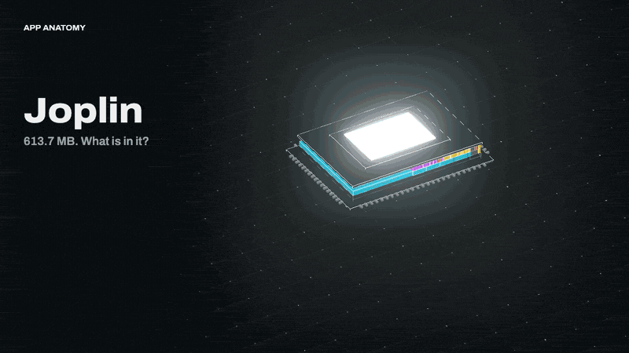
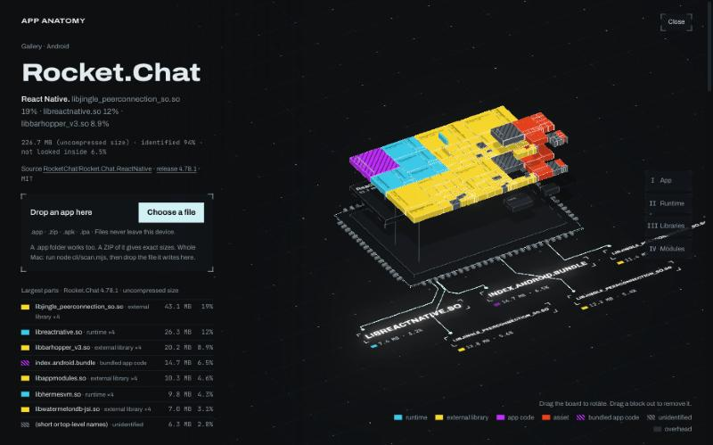
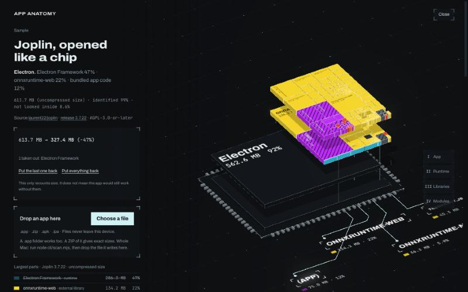
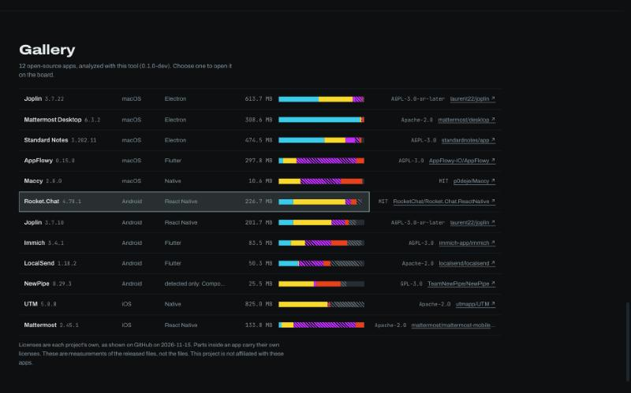
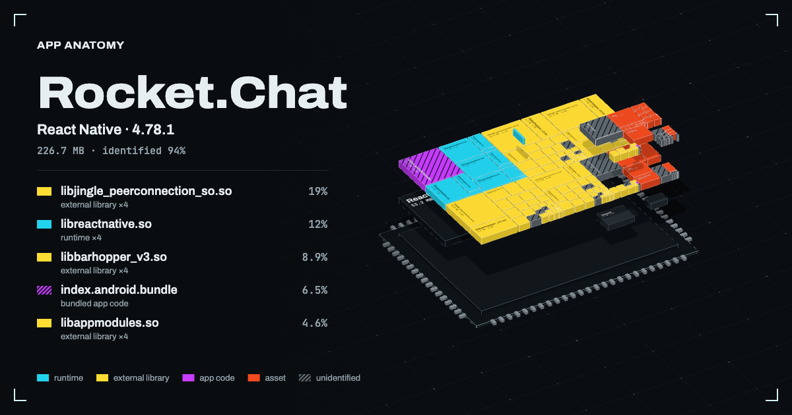

<h1 align="center">App Anatomy</h1>

<p align="center">
  <b>See what the apps on your Mac are made of.</b><br>
  Runtime, libraries, own code and assets, with bytes. Nothing is uploaded.
</p>

<p align="center">
  <a href="https://github.com/scs0209/app-anatomy/actions/workflows/rules.yml"></a>
  <a href="https://www.npmjs.com/package/app-anatomy"></a>
  <a href="package.json"></a>
  <a href="LICENSE"></a>
  
</p>

<p align="center">
  <a href="https://scs0209.github.io/app-anatomy/"><b>Try it in the browser</b></a> ·
  <a href="#-quick-start"><b>Quick start</b></a> ·
  <a href="#-how-to-read-it"><b>How to read it</b></a> ·
  <a href="#-gallery">Gallery</a> ·
  <a href="#-how-it-works">How it works</a> ·
  <a href="CONTRIBUTING.md">Contribute a rule</a> ·
  <a href="README.ko.md">한국어</a>
</p>

<p align="center">
  
</p>

---

Joplin, a note-taking app, is 613.7 MB on a Mac. 47% of that is the Electron framework, 22% is an AI inference
runtime (onnxruntime-web), and the app's own bundled code is 12%. App Anatomy opens an app like a chip package and
shows you this: each part as a block, sized by its bytes, colored by where it came from.

One command scans every app installed on your Mac. Apps are read, never run, and nothing leaves your machine.

## ✨ Why App Anatomy

| | |
|---|---|
| 🖥 **Your whole Mac in one command** | `npx app-anatomy scan --open` reads every app in `/Applications` and tells you things like how many copies of Electron you have installed and how much disk they take together. |
| 📦 **Or one app** | A `.app` folder, a ZIP with a `.app` inside, an Android APK or an iOS IPA. Electron, Flutter, React Native and native apps are recognized. |
| 🧩 **A chip you can open** | Area is bytes, height is the layer (app, runtime, library, module), color is the origin. The camera is orthographic, so equal areas look equal. |
| ✋ **Take a block out, see what falls** | Drag a block off the chip. The size is recounted, and every part that declares it needs that block goes dark with it. In Joplin, removing the 0.4 MB `onnxruntime-common` takes 218 MB down with it. |
| 🔒 **Nothing is uploaded** | The analyzer is Rust compiled to WebAssembly and runs on your machine. The result page is served from `127.0.0.1` and makes no outside requests. |
| 🧾 **Honest about what it does not know** | Unidentified parts stay gray and hatched. A parent's bytes always equal the sum of its children. |
| 🤝 **Rules anyone can add** | A part is named by a few lines of JSON. 651 rules so far; you only need Node to write and test one. |

<p align="center">
  
</p>

## 🚀 Quick start

**Scan your Mac** (needs Node 18 or newer):

```bash
npx app-anatomy scan --open
```

It prints one line per app, writes `this-mac.anatomy-scan.json`, and opens the result in your browser. That file
lists the apps you have installed, so share it only if you mean to. Add `--system` to include `/System/Applications`,
or pass folders to scan those instead.

**Look inside one app:**

```bash
npx app-anatomy path/to/Some.app                     # a summary in the terminal
npx app-anatomy some.apk --json result.json          # the full result as JSON
```

```
android-release.apk · apk · 226.7 MB (uncompressed)
runtime: react-native 23.5%
largest: libjingle_peerconnection_so.so 19.0% · libreactnative.so 11.6% · libbarhopper_v3.so 8.9%
identified 94.0% · not looked inside 6.5% · overhead 2.8%
```

**In the browser, by drag and drop:** [scs0209.github.io/app-anatomy](https://scs0209.github.io/app-anatomy/) does the same without the terminal: drop an app file, or
browse the [gallery](https://scs0209.github.io/app-anatomy/?app=rocket-chat). Files are analyzed in your browser tab and never leave it. It can also
reopen a saved result JSON. The site is in English and Korean; switch at the top right. To run the site yourself:

```bash
git clone https://github.com/scs0209/app-anatomy && cd app-anatomy
node site/build.mjs && python3 -m http.server 8767 --bind 127.0.0.1 --directory site-dist
```

## 🧭 How to read it

| Sign | Meaning |
|---|---|
| **Area** of a block | bytes (uncompressed) |
| **Height** it sits at | the layer: app, runtime, library, module |
| **Color** | where the part came from: runtime, external library, the app's own code, asset |
| **Gray with hatching** | unidentified: no rule names it yet |
| **A color with hatching** | we know whose it is but did not look inside (for example an app's bundled code) |
| **Traced labels** | the largest parts, with size and share |
| **A block gone dark and sagging** | a part that declared it needs the block you took out |

One sign carries one meaning. Nothing decorative is drawn in an origin color.

## 📸 Screenshots

| | |
|---|---|
|  |  |
| **Take it out**: drag a block off the chip, or click a row in the table, and the size is recounted | **Gallery**: twelve open-source apps, each with its source repository and license |
|  | |
| **Share card**: a 1200×630 image of the view you composed, made in your browser | |

On narrow screens the chip is replaced by a flat treemap with the same areas and colors.

## 🗂 Gallery

Twelve open-source apps, analyzed with this tool. Open any of them [on the site](https://scs0209.github.io/app-anatomy/). The results are in `site/gallery/`, with the repository, release and
license of each in [`site/gallery/SOURCES.md`](site/gallery/SOURCES.md).

| App | Platform | Size | Built with | Runtime share | Identified |
|---|---|---|---|---|---|
| Joplin | macOS | 613.7 MB | Electron | 46.8% | 99.3% |
| Mattermost Desktop | macOS | 280.2 MB | Electron | 94.0% | 99.9% |
| Standard Notes | macOS | 474.5 MB | Electron | 53.4% | 100.0% |
| AppFlowy | macOS | 297.6 MB | Flutter | 5.0% | 100.0% |
| Maccy | macOS | 10.6 MB | native | n/a | 99.7% |
| Rocket.Chat | Android | 226.7 MB | React Native | 17.0% | 94.0% |
| Joplin | Android | 201.7 MB | React Native | 16.9% | 91.3% |
| Immich | Android | 83.5 MB | Flutter | 14.2% | 83.8% |
| LocalSend | Android | 50.3 MB | Flutter | 22.7% | 62.7% |
| NewPipe | Android | 25.5 MB | native (Compose detected) | n/a | 92.9% |
| UTM | iOS | 825.0 MB | native | n/a | 59.9% |
| Mattermost | iOS | 138.0 MB | React Native | 3.5% | 99.9% |

"Runtime share" counts the bytes of the runtime itself. The terminal summary's `runtime:` line is larger for some apps because it also counts what the runtime carries (for React Native, the JavaScript bundle). "Identified" is the share of bytes whose origin the tool could say. A workflow checks weekly for new releases and
opens a pull request with refreshed results. These are measurements of the released files, not the files. This
project is not affiliated with these apps.

## 🧠 How it works

```
an app file or folder
  → a host reads bytes on request (Node for the CLI, a Web Worker in the browser)
  → the analyzer (Rust, compiled to WebAssembly)
      · unpacks the container: .app bundle, ZIP, APK, IPA, asar, dex
      · detects the runtime: Electron, Flutter, React Native, or native
      · names parts with rules: file names, framework names, paths, class prefixes, npm package names
      · accounts for every byte: a parent equals the sum of its children
      · records declared dependencies between parts: npm package dependencies, DT_NEEDED, LC_LOAD_DYLIB
  → one result JSON (schema in schema/)
  → the terminal summary, the 3D chip, the flat treemap, the list, the share card
```

* **One analyzer, two hosts.** The command line and the browser run the same WebAssembly file and produce the same
  bytes of JSON for the same input.
* **Rules are data.** `rules/builtin/builtin.json` holds this project's own rules; `rules/imported/` holds rules
  converted from [LibChecker-Rules](https://github.com/LibChecker/LibChecker-Rules). No regular expressions: literals,
  prefixes and a restricted glob.
* **Exact byte accounting.** Sizes are uncompressed. Whatever is not attributed to a part is shown as overhead, not
  hidden.
* **Small parts are lumped for drawing only.** The chip groups very small parts into one block per origin; the list
  and the JSON keep every part.

## 🤝 Contributing a rule

The gray hatched blocks are parts nobody has named yet. One rule took Rocket.Chat's Android app from 90.9% to 94.0%
identified:

```json
{
 "id": "lib.watermelondb",
 "name": "WatermelonDB",
 "kind": "library",
 "category": "other",
 "homepage": "https://github.com/Nozbe/WatermelonDB",
 "match": [
  { "target": "file-name", "type": "literal", "value": "libwatermelondb-jsi.so", "packaging": ["apk"] }
 ]
}
```

```bash
node rules/tools/unidentified.mjs path/to/app.apk    # the largest unidentified parts, with a guessed condition
node rules/tools/check.mjs                           # validate every rule file
```

**[CONTRIBUTING.md](CONTRIBUTING.md)** walks through it from finding a part to opening the pull request. A wrong name
is worse than no name, so the most useful report is a part that was labeled incorrectly.

## 🤖 Use it from a coding agent

`skills/app-anatomy/` is an agent skill. With it, an agent asked "why is this APK so big?" or "what is this app built
with?" runs the tool, reads a short digest of the result instead of the whole file, and answers with the numbers.
Copy the folder into your agent's skills directory (for Claude Code, `~/.claude/skills/`). It needs Node and `npx`.

## ❓ FAQ

<details><summary><b>Is anything uploaded?</b></summary>

No. The analyzer runs on your machine, in Node or in your browser tab. `scan --open` serves the result page from
`127.0.0.1` only, and the page loads its fonts and scripts from that same address.
</details>

<details><summary><b>Does it run the apps it reads?</b></summary>

No. It reads file names, sizes and the bytes it needs to identify parts. Nothing is executed.
</details>

<details><summary><b>Why is so much of my Mac gray?</b></summary>

A library is recognized only if a rule names it, and most rules so far are for Android libraries and Electron apps.
Large native Mac apps are mostly unidentified: on the author's Mac, 31% of all bytes were identified. Each gray block
is a rule waiting to be written.
</details>

<details><summary><b>What does "take it out" tell me?</b></summary>

The size without that part, and which other parts declare that they need it. Those come from what the files say:
`dependencies` in a package's `package.json`, the libraries a binary lists as needed (`DT_NEEDED` in ELF,
`LC_LOAD_DYLIB` in Mach-O), and the fact that an Electron app's code needs the Electron framework. Nothing is run,
so a dependency that is not declared (code loaded by name at run time, Java classes calling each other) does not
show, and "goes down with it" means "says it needs it", not "was observed to fail".
</details>

<details><summary><b>Does it work on Windows or Linux?</b></summary>

Analyzing one app file (an APK, an IPA, a ZIP with a `.app`) only needs Node, but it has been run on macOS only.
`scan` looks for `.app` bundles, so it finds nothing elsewhere.
</details>

<details><summary><b>How is this different from an APK analyzer or a bundle analyzer?</b></summary>

Those go deeper into one platform or one bundler. This shows several platforms and runtimes the same way, names
third-party libraries from shared rules, and can look at everything installed on a machine at once.
</details>

## ⚠️ Limitations

* **Scanning a machine is macOS only.**
* **Native apps are mostly unidentified** until rules exist for their libraries.
* **Dependencies are the declared ones only.** Nothing is run to confirm them.
* **Encrypted iOS apps** (App Store downloads) show structure only.
* **"Not looked inside"** parts are attributed to an origin but not broken down further.
* **Checked in Chromium-based browsers.** Safari and Firefox are not verified yet.
* **There is no automated test suite for the site.** It has been checked by hand.
* **"App Anatomy" is a working name.**

## 🛠 Run from source

```bash
git clone https://github.com/scs0209/app-anatomy && cd app-anatomy
node cli/main.mjs scan --open            # the CLI needs no build: the analyzer is checked in at dist/
sh core/build-wasm.sh                    # rebuild the analyzer (needs Rust with the wasm32-unknown-unknown target)
node rules/tools/check.mjs               # validate the rule files
```

```text
core/     the analyzer, Rust compiled to WebAssembly
cli/      the command-line tool: one app, or scan a Mac
site/     the static site: 3D chip, treemap, list, search, share card, gallery
rules/    identification rules and the tools to write and check them
schema/   the result format and the rule format
host/     the code that feeds bytes to the analyzer in Node and in the browser
skills/   a skill for coding agents
```

If App Anatomy is useful to you, **a ⭐ on this repo helps more people find it.**

## 📄 License

[Apache-2.0](LICENSE). Rules imported from LibChecker-Rules are Apache-2.0; the site bundles
[three.js](https://threejs.org) (MIT) and the Archivo, JetBrains Mono and Pretendard fonts (OFL 1.1). Details are in
[NOTICE](NOTICE).
